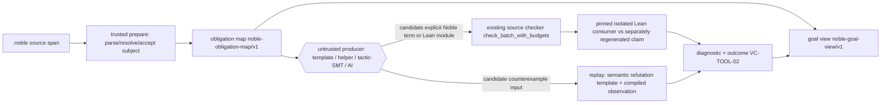
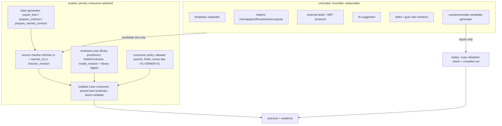

## Context

Issue #6 asks for a design and evaluation plan for a Dafny-style authoring workflow over Noble contracts. Its comment adds an Arend-inspired goal/context view and transparent proof helpers. This document is design only. It selects no syntax, changes no code and claims no new evidence. Every proposed command, report field, limit and scenario below is a design proposal unless the text cites existing source.

### Baseline at `44329dc` (grounded in source)

The issue links are pinned to `0ea10d3`. `git log 0ea10d3..44329dc` contains one commit, and `git diff --stat` shows no change between the two revisions under `.cairn/specs/{program-contracts,developer-experience,verification,evidence}`, `.cairn/changes/intrinsic-noble-proofs/`, `crates/noble-contracts/src/intrinsic*` or `crates/noble-cli/src/workflow/`. The cited proof-checker and verification baseline is therefore current. The same commit does change other files: calculator fixtures, declared-module nominal-signature code under `crates/noble-contracts/src/source/`, a 10-line calculator dispatch in `crates/noble-cli/src/main.rs` and 76 new test lines at line 124 of `crates/noble-contracts/tests/declared/cases.rs`. Line numbers in those files shift relative to `0ea10d3`. All line numbers in this document refer to `44329dc`.

- **MC1 commands.** `noble verify CONTRACT [--emit DIR] [--proof FILE | --refutation FILE] [--timeout-ms N]` and `noble explain-proof CONTRACT` print `noble-mc1-report/v1` (VC-TOOL-01). Without evidence, `verify` returns `unknown` (exit 3) and performs no search. The seven claim outcomes and exit codes are fixed by VC-TOOL-02 and implemented as `Outcome` in `crates/noble-cli/src/workflow/output.rs:4-35`.
- **MC1 submissions are producer-authored Lean.** A submitted MC1 proof is a producer-authored Lean module (`MC1Proof.proof`/`MC1Proof.refutation`). It is compiled and replayed in a separate kernel consumer with axiom inspection (`workflow/verification.rs:89-124`). Tactic scripts are accepted on this path. For example, `verification/mc1/monotonic-refutation.lean` uses `by`, `simp` and `simpa` to refute `(ensures (lt (in x) (out y)))` for `[ 1 + ]` at `x = 9223372036854775807`. This is the existing entry for an external tactic producer.
- **Intrinsic module command.** `noble verify-module SOURCE [--module FILE ...] [--timeout-ms N]` (`crates/noble-cli/src/main.rs:86`, `workflow/intrinsic.rs:514-569`) prints `noble-intrinsic-module-report/v1`. Its stages are `parse`, `resolve`, `link`, `check`, `source-exhausted`, `acceptance`, `proof-check` and `independent-recheck`. When no proof was accepted, the report outcome is the string `"unproved"` (`workflow/intrinsic.rs:529`). That string is not one of VC-TOOL-02's seven outcomes, which is a reporting gap this design closes (§6).
- **Source proof calculus.** The bounded pure checker (`crates/noble-contracts/src/intrinsic.rs:864-1127`) accepts exactly these forms:
  - `(use NAME)`: a local premise binder or an earlier accepted, exported proof.
  - `(apply F ARG)`: binary. ARG is a `Type0` code, a bound value *variable* or a checked premise proof.
  - `(refl x)`: `x` is a bound value variable.
  - `(intro (NAME SORT) BODY)`.
  - `(subst (motive (v CODE) EQPROP) EVIDENCE PREMISE)`.

  Equality operands are bound variable names only (`intrinsic.rs:679-695`), so no value expression language exists. Premise binders are `Eq` propositions. Goal agreement is structural identity after binder-level rebasing (`AfterInfer`, `intrinsic.rs:1060-1070`).
- **Contract proofs are already reviewed templates.** The revision-1 contract checker (`intrinsic.rs:1289-1329`) recognizes exactly one skeleton: `(export-unary-I64 (intro (tail Stack) (intro (x I64) (pc-sequence (pc-exact (exec-literal N)) (pc-exact (exec-add)) (bridge (by-exact-append-assoc)) (join (by-exact-result))))) (mc1-true-eq-wrap))`. It emits a host-generated Lean term, `lower_unary_add(N)`. Revision 2 (`intrinsic/named_v2.rs:462-489`) likewise recognizes `export-named-unary-I64` with two `pc-named-call` slices and emits a fixed host term. Every omitted or foreign constructor fails with `unknown or ill-formed proof constructor` (`intrinsic.rs:219-223`). In other words, Noble's current contract proofs are already *reviewed proof templates* checked by a recognizer, with Lean recheck against the separately exported `MC1Obligation.claim`.
- **Diagnostics.** `DiagnosticKind` is `{Invalid, Unsupported, Exhausted, Internal}` (`crates/noble-contracts/src/lib.rs:61-66`). An ordinary-typing `JoinDiagnostic` carries word, expected/actual stack, constraint and value origin (`lib.rs:77-84`). The CLI maps intrinsic diagnostics to codes such as `intrinsic-source-invalid`, `normalization-work-exhausted` and `substitution-work-exhausted` (`workflow/intrinsic.rs:377-383`). A stale dependency reports `unsupported` with code `intrinsic-stale-proof` (`workflow/intrinsic.rs:178-213`).
- **Independent recheck.** `verify_intrinsic_pure` (`workflow/verification.rs:126+`) compiles `theorem intrinsic_proof : {claim} := {term}` in an isolated session. It accepts only the axioms `propext`, `Classical.choice` and `Quot.sound`. Contract proofs are rechecked against `noble_contracts::export_lean(&typed)`, which comes from the contract and not from the proof text (`workflow/intrinsic.rs:404-416`). Dependencies must match the current `model_revision()`/`checker_revision()` (`workflow/intrinsic.rs:178-213`).
- **Limits.** Defaults are 65,536 source bytes, 16,384 nodes, depth 64 and 2,000,000 work (`lib.rs:43-50`). `ProofBudgets` meter normalization and substitution separately (`intrinsic.rs:119-126`). The `--timeout-ms` range is 1-600000 with a default of 120000 (VC-TOOL-01).
- **Editor holes.** Editor holes exist only as editor-only `noble-editor/v1` nodes for executable syntax (DX-HOLE-01, active change `editor-hole-transport`). Proof holes have no transport.

**Drift notes.** At `44329dc`, VC-TOOL-01 and §8.3 of the program-contracts spec link `README.md#using-mc1-contracts` and `README.md#mc2-companion-sessions-and-proof-required-builds`. Neither heading exists in `README.md`. The README's Verification section only states that `noble verify` checks supplied evidence without proof search. The intrinsic design cites `Obligation.lean` lines 34-42 for `exportedClaim_consequence` and 64-76 for `exportedClaim_unaryI64`. Those theorems start at lines 32 and 65 respectively. `Rules.lean` citations 230, 248, 378 and 389 match. Nothing in this change depends on the missing anchors.

### Goals and non-goals

Goals:

- Explain unmet obligations.
- Let untrusted producers propose explicit evidence.
- Show every remaining obligation.
- Keep producer failure distinct from falsity.

Non-goals, as stated in the issue:

- No implementation, syntax commitment, mandatory proofs or general automatic verification.
- No new trusted solver or rule.
- No claim that testing establishes a theorem.
- No HoTT/path types, higher inductive types, universe expansion, circular libraries or replacement of Lean.
- No reusable call-rule generalization (#7) or artifact correspondence (#10).

## Decisions

### Decision: Source-located obligation map as the shared substrate

**Choice:** Every producer, the goal view and every diagnostic consume one host-generated, read-only **obligation map** (proposed report `noble-obligation-map/v1`). Only the trusted claim generator writes it: MC1 `prepare`/`export_lean` or intrinsic `prepare_contract`/`prepare_named_contract` and the pure proposition parser. Producers never write it. Each entry has the following fields.

| Field | Content | Source of truth today |
|---|---|---|
| `key` | `module@version / declaration / revision / site-path`, e.g. `arithmetic@1/increment-correct/1/export-unary-I64.0.intro.intro.pc-sequence.bridge` | Resolved declaration identity; site path over the selected template skeleton |
| `statement_digest` | SHA-256 of the exact generated Lean statement text for this site | `export_lean`, `lean_proposition` |
| `subject` | Module, version, definition, session-local definition identity, accepted submission, exact source span | `SubjectBinding` (`intrinsic.rs:45-67`) |
| `stacks` | Ordered `input`, `intermediate[]` and `output` stacks, each `tail ++ [typed slots]`, with the preserved bottom tail named explicitly | Contract `inputs`/`outputs`, template slices `s0, m0, m1, t0` |
| `pre`, `post` | MC1 term roots with spans, `(in x)`/`(out y)` namespaces kept distinct | `ContractGoal.requires/ensures` |
| `sites` | Bridge `∀ s m, P s → R s m → P' m` and join `∀ s m t, P s → R s m → Q m t → T s t` instantiated per `pc_sequence` (`Rules.lean:378-387`) | Template recognizer |
| `arithmetic` | `I64` = BitVec 64 two's-complement wrapping; `lt`/`le` signed | VC-NUM-01, MC1 §8.1 |
| `assumptions` | Explicit premises (Δ), allowed axioms, model/rule/checker revisions, consumer policy | `model_revision()`, `checker_revision()`, allowed-axiom list |
| `kind` | `partial-correctness` (normal return only); never `total`/`prefix-safety` in P1 | VC-LOGIC-01/03 |
| `vacuity` | `none` / `suspected` (untrusted producer note) / `checked` (accepted proof of `¬∃` pre) | New, see §7 |

**Rationale:** VC-INPUT-01 already requires a typed contract IR with exact references. DX-PROOF-01 already requires spans across every stage. What is missing is a *stable, addressable* projection that tools can share. Keys are structural, not positional in the source bytes, so editing an unrelated declaration does not invalidate them. Digests, by contrast, change whenever the statement changes. r[PAUTO-MAP-01]

### Decision: Workflow and API sketch (source span → obligation → producer → independent check → diagnostic)

**Choice:** The workflow uses the following stages. The command names are proposals and none is selected.



1. `noble explain-proof CONTRACT` and a proposed `noble obligations SOURCE [--module FILE ...]` prepare the subject and emit the obligation map. Like `explain-proof` today, they are `not-run` and never launch Lean.
2. A producer request is `{obligation key, statement_digest, producer id+revision, budget}`. The response is either a *candidate text* (an explicit Noble proof term to splice at the site, or an MC1 `MC1Proof.lean` module) or a *candidate counterexample* (concrete input values). A response never contains a claim, an accepted flag, an axiom list or a rule definition. Any such field is ignored and logged as a producer protocol violation.
3. The host splices the candidate into a copy of the source and runs the **existing** route: `verify-module`, i.e. `check_batch_with_budgets` followed by `verify_with_evidence`, or MC1 `verify --proof`. It never runs a new acceptance path.
4. The report adds `producer` provenance (id, revision, budget used, candidate digest) as non-authoritative metadata. Acceptance evidence records only the explicit term, claim, model/checker revisions and axioms. It never records the producer invocation, so replay needs no producer (§5).

**Rationale:** This reuses the one independently tested acceptance path. Producer output is data, as VC-TOOL-03 and VC-EVIDENCE-01 require.

### Decision: Trust and dependency boundary with pinned versions and budgets

**Choice:**



Pinned identities are recorded in every report. The producer's own identity is recorded but has no effect on acceptance.

- Lean toolchain: `proofs/mc1/lean-toolchain`.
- Reviewed library digest and `model_revision()`/`named_model_revision()`.
- `checker_revision()`/`named_checker_revision()`.
- Consumer policy revision.
- Obligation-map schema revision.
- Producer id and revision.

**Budgets.** Two disjoint budget pools exist so that a producer cannot starve the checker or influence its limits:

- **Producer pool.** This pool is new and enforced by the host around an isolated subprocess. It covers wall time, CPU, memory, candidate count, candidate bytes and solver calls. Its proposed P1 defaults are 10 s wall time, 256 MiB, 8 candidates, 16 KiB per candidate term and 64 KiB per candidate Lean module. These numbers are design parameters to calibrate, not measurements.
- **Checker pool.** This pool already exists. It covers `Limits`, `ProofBudgets` and `--timeout-ms` for the Lean consumer. Spliced candidate bytes count against the checker's 65,536-byte source limit. The producer pool and the checker pool never share counters.

Exhaustion of the producer pool yields `unknown` with `producer-exhausted`, because no evidence was checked. Exhaustion of the checker pool yields `timeout`, or `error` with `exhausted`, exactly as VC-TOOL-02 already specifies.

**Rationale:** VC-TOOL-03, VC-EVIDENCE-01/04 and VC-INTRINSIC-05 already fix the trusted side. This decision only names the untrusted side and its bounds. No producer can add an axiom, rule, `use` target, policy or claim. r[PAUTO-PRODUCER-01]

### Decision: Compare three producer approaches; unsupported cases stay explicit

**Choice:** The comparison below drives the recommendation. Latency and size figures are **unmeasured design estimates** [INFERENCE]. Except where a column cites source, the evaluation harness (§10) must measure them before any selection is final.

| Criterion | A. External tactic/SMT producer | B. Reviewed proof templates | C. Bounded hole/helper suggestions |
|---|---|---|---|
| What it emits | MC1 `MC1Proof.lean` (tactics allowed on the MC1 path today), or, for intrinsic, a reconstructed explicit Noble term | An explicit Noble term instantiating a reviewed skeleton, e.g. `export-unary-I64 … (exec-literal N) …` | One explicit core step (`intro`, `apply`, `refl`, `subst`, `use`, or `pc-sequence` with open bridge/join) |
| Coverage | Widest *proposal* coverage over MC1 arithmetic/structural predicates. In the intrinsic path, coverage is limited to what reconstructs to existing forms, because no raw Lean is admitted (K-PROOF-01). | Exactly the reviewed families. At `44329dc` these are unary I64 literal-then-add (rev 1) and the two-call named step (rev 2). | Pure `Type0`/`Pi`/`Eq` fragment plus composition scaffolding. Never closes arithmetic or contract goals on its own. |
| Latency | Seconds or more for solver plus Lean compile [INFERENCE] | Milliseconds to expand, plus the existing Lean recheck [INFERENCE] | Milliseconds per step, plus recheck [INFERENCE] |
| Diagnostic usefulness | Solver models give concrete counterexample candidates. Failures (`unknown`) carry little structure. | Precise. The failing slot is named, e.g. `bridge`, `literal rule does not match first subject slice` (`intrinsic.rs:1315`). | Precise per step. Shows the remaining goal. |
| Evidence size | Unbounded and producer-dependent. Must be capped (64 KiB proposed). | Small source term (< 300 bytes for the increment skeleton) plus a fixed host-generated Lean term (`lower_unary_add`, a constant of a few KB) | Small. Grows linearly with steps. |
| Trust surface added | None if checked by the existing consumer, but a large untrusted input to the Lean compile session | None. Templates are recognizers of reviewed rules that already exist. | None. Output is ordinary core syntax. |
| Unsupported, explicit | Text literals, `Program`/`Syntax` equality, resources and effects, prefix-safety/total (MC1 §8.1). Any non-reconstructible proof on the intrinsic path. | Any subject or contract outside a reviewed family: `selected unary I64 rule requires typed True precondition` (`intrinsic.rs:1293-1297`) | Motive synthesis beyond `Eq` motives, value expressions (only variables exist), all contract goals except as scaffolding |

**Rationale:** Approach B is the only one whose output already matches the *current* intrinsic acceptance shape. C is cheap, transparent and fits the Arend-style workflow requested in the comment. A gives the best counterexamples but adds the largest untrusted input and has no reconstruction path into intrinsic source. P1 therefore selects B+C and keeps a counterexample generator that needs no solver (§7). A becomes a follow-on profile whose output must still reach acceptance through MC1 `--proof` or reconstruct into explicit Noble terms. Unsupported goals are reported as `unsupported` before any producer runs and are never silently weakened (VC-INPUT-02).

### Decision: Goal/context view derived from the independent checker

**Choice:** The proposed report is `noble-goal-view/v1`, rendered by an editor or the CLI. It is a read-only projection of the obligation map plus the latest checker result for the exact `statement_digest`. For each focused site it shows the following.

1. The **independently selected expected claim**, rendered from the claim generator and not from the proof text, plus the exact subject/module revision. For revision 1 this is `MC1Obligation.claim` from `export_lean`.
2. **Complete ordered stacks.** For contract sites: input `tail ++ [x]`, each intermediate stack, and output `tail ++ [wrap64(x+1)]`, with the bottom tail displayed as its own row.
3. **Typed locals and premises.** Γ binders with codes, Δ premise binders with their `Eq` propositions, explicit assumptions, model/profile and allowed axioms.
4. For a failed composition, the **precise remaining bridge or join obligation**, with the two predicates or stacks that must agree displayed side by side.
5. **Inserted arguments and selected rule/theorem identities.** These are the elaborated `apply` arguments from #12 and the exact `use` target `module@version/name` with its digest.

A status chip comes only from checker output. The view never infers status from producer output or from editor state.

| Chip | Derived from | Meaning shown |
|---|---|---|
| `checked` | Source checker passed **and** Lean consumer accepted for this exact digest | "partial correctness for normal return; not termination, not artifact correspondence" is always appended |
| `incomplete` | Site contains an editor proof hole or no proof yet; VC-TOOL-02 outcome `unknown` | Never accepted; never satisfies proof-required admission (DX-HOLE-01, VC-TOOL-04) |
| `unsupported` | `DiagnosticKind::Unsupported` or outcome `unsupported` | Outside the profile; not false |
| `refuted` | Accepted refutation (`disproved`) | Shows the input, output and violated predicate (§7) |
| `exhausted` / `timeout` | `DiagnosticKind::Exhausted` / outcome `timeout`; producer-pool exhaustion shown separately as `producer-exhausted` | Not false; budget named |
| `internal` | `DiagnosticKind::Internal` or consumer crash | Not false; tool defect |
| `stale` | Any key input digest changed since the result was computed (§8) | Prior result no longer applies to this source |

Every chip keeps the original claim and assumptions visible. `checked` is never rendered for a site whose surrounding declaration contains any hole.

**Proof holes.** A proof hole is an editor-only node and never `.noble` syntax. The proposal is a `proof-hole` variant in the editor transport, analogous to the `noble-editor/v1` executable hole. Like DX-HOLE-01's executable holes, it must reject on every admission path. Its "type" is the goal at that site.

**Worked source-to-goal UI sketch.** The source is the CONTRACT-18 increment proof with the bridge **omitted**. In the source below, the author forgot the bridge, and the producer/helper left the site open as an editor hole. The sketch is not checked by any tool.

```text
module arithmetic@1 [
  def increment [ 1 + ]                                      # span 21..43
  contract 1 increment-law [ subject increment
    input [ x I64 ] output [ y I64 ]
    requires [ true ]
    ensures [ (eq (out y) (add (in x) 1)) ] ]                # span 160..199
  proof 1 increment-correct for increment-law
    [ (export-unary-I64
        (intro (tail Stack) (intro (x I64)
          (pc-sequence (pc-exact (exec-literal 1))
            (pc-exact (exec-add))
            ⟦bridge ?⟧                                        # editor hole, span 391..401
            (join (by-exact-result)))))
        (mc1-true-eq-wrap)) ]
]
```

```text
┌ Goal: arithmetic@1/increment-correct/1/…/pc-sequence.bridge          [incomplete] ┐
│ Expected claim (generated from increment-law, not from this proof):               │
│   MC1Obligation.claim  digest 9f3c…  model r…  checker r…  ⟶ open full statement  │
│ Subject: arithmetic@1 increment [ 1 + ]  (span 21..43)  kind: partial-correctness │
│ Context Γ:  tail : Stack   x : I64            (intro spans 268..282, 284..295)     │
│ Premises Δ: (none)        Axioms allowed: propext, Classical.choice, Quot.sound    │
│ Stacks (bottom-first; tail preserved):                                             │
│   s0 = tail ++ [x]                    input            ⟶ span 268..295              │
│   m0 = s0 ++ [1]                      after (exec-literal 1) as left R  ⟶ 309..335 │
│   m1 = tail ++ [x, 1]                 required by (exec-add) as right P' ⟶ 336..357 │
│   t0 = tail ++ [wrap64(x + 1)]        output            ⟶ ensures 160..199          │
│ Remaining obligation (bridge, Rules.lean pc_sequence):                             │
│   ∀ s m, s = s0 → m = m0 → m = m1                                                  │
│   left R(s,m):  m = s0 ++ [1]        ≠ syntactically   right P'(m): m = tail ++ [x,1]│
│   note: append associativity is NOT definitional; refl cannot close this.          │
│ Candidates (untrusted, unchecked until spliced): (bridge (by-exact-append-assoc))  │
│ Inserted args (#12): none   Selected rules: exec_lit_iff, exec_add_iff, pc_exact,  │
│   pc_sequence (reviewed library digest …)                                          │
│ This view is not a termination, Wasm or host-authorization claim.                 │
└────────────────────────────────────────────────────────────────────────────────────┘
```

Every `⟶ span` is a navigation link to its source span. The spans in this sketch are illustrative offsets, not measured. Activating the bridge row moves the cursor to the hole. Activating `m1` moves to the `(pc-exact (exec-add))` slice whose precondition requires it. Activating the claim opens the exact generated statement text.

**Rationale:** DX-DIAG-01 requires required/actual stacks and spans for ordinary typing, and DX-PROOF-01 requires distinct proof failure kinds. This view applies the same discipline to proof goals and adds the Arend-style context display. r[PAUTO-GOAL-01] (related: DX-PROOF-01, DX-DIAG-01)

### Decision: Transparent helpers expand into ordinary proof terms

**Choice:** Helpers are untrusted producers selected through the editor or CLI. They have **no `.noble` syntax**, so there is no syntax commitment. Each helper returns a replacement term for one site plus the list of remaining sites, and the "replace helper with result" action splices that explicit text into the source. Acceptance depends only on the spliced explicit term, so accepted evidence replays with no helper present.

| Helper | Input | Emitted explicit term | Remaining obligations | Refusals |
|---|---|---|---|---|
| `intro*` | Pi goal | Nested `(intro (n S) …)` using the goal's binder names and sorts | The body goal | Non-Pi goal |
| `exact-use T` | Goal, exact resolved `T` | `(use T)` or the `(apply … )` chain from #12 elaboration | Explicit premises of `T` | Unresolved, private, forward or cyclic `T` (`intrinsic.rs:940-946`); `T` whose claim mismatches the goal |
| `apply-use T args` | As above with partial args | `(apply (apply (use T) a1) a2)` | Premise arguments become new holes, never assumptions | Premise inference (see #12) |
| `refl` | `Eq A a b` goal | `(refl a)` | none | `a`, `b` not the same bound variable (structural identity); never for merely behaviorally equal values |
| `subst M e` | Goal, explicit motive, equation | `(subst (motive (v C) M) e p?)` | Premise `M(a)` | Motive not an `Eq` proposition (`intrinsic.rs:1088-1090`); motive synthesis is out of scope |
| `compose` | Contract site over a reviewed family | `(pc-sequence L R (bridge ⟦?⟧) (join ⟦?⟧))` with `L`, `R` from the subject slices | **Bridge and join always remain** as explicit sites | Never fills bridge/join with an unchecked rule; never merges them |
| `template unary-I64-add` | Contract that the recognizer's preconditions accept | The full CONTRACT-18 skeleton with the subject's literal | none, if accepted | Contract outside the family → `unsupported` |

**Worked helper expansion.** None of the terms below were checked by any tool for this change. The same text shapes are exercised by the CONTRACT-25 fixture builder (`verification/intrinsic-proofs/fixtures.mjs:33-44`) and the accepted CONTRACT-17 source.

Module `logic@1` contains the accepted `poly-refl : (Pi (A Type0) (Pi (x A) (Eq A x x)))`. Goal: `proof 1 list-refl : [ (Pi (x (List I64)) (Eq (List I64) x x)) ]`.

1. Helper `intro*` emits `(intro (x (List I64)) ⟦?⟧)`. The remaining goal is `(Eq (List I64) x x)` with `Γ = x : El (List I64)`.
2. Helper `exact-use poly-refl` at `⟦?⟧` emits `(apply (apply (use poly-refl) (List I64)) x)`. The goal view lists `inserted: A := (List I64), x := x` and `selected: logic@1/poly-refl digest …`.
3. The final expansion is `(intro (x (List I64)) (apply (apply (use poly-refl) (List I64)) x))`.
4. The hand-written explicit alternative is `(intro (x (List I64)) (refl x))`.

Both terms go through `check_batch_with_budgets` and then `verify_intrinsic_pure` against the **same** claim, which `lean_proposition` renders from the declared proposition and not from either term. By analogy with the asserted rendering in `crates/noble-contracts/tests/declared/cases.rs:1104-1105` [INFERENCE], that claim is `(∀ (v0 : El (.list .i64)), v0 = v0)`. Acceptance of one term implies nothing about the other; each is a separate submission. The scenario PAUTO-CASE-09 requires byte-identical claim digests for both submissions.

**Composition helper.** At the CONTRACT-18 site, `compose` emits `(pc-sequence (pc-exact (exec-literal 1)) (pc-exact (exec-add)) (bridge ⟦?⟧) (join ⟦?⟧))`. The goal view then shows the bridge (above) and the join `∀ s m t, s = s0 → m = m0 → t = t0 → t = t0`. The helper may *suggest* `by-exact-append-assoc`/`by-exact-result`, but those suggestions are unchecked text until spliced. `refl` is refused for the bridge because `m0` and `m1` are not structurally identical (the intrinsic design states that symbolic append associativity is not definitional).

**Rationale:** This meets the comment's request for helpers that a human can inspect: each helper output is ordinary core syntax that is checked independently. r[PAUTO-PRODUCER-01]

### Decision: Diagnostics taxonomy keeps VC-TOOL-02 outcomes and adds categories

**Choice:** This design adds no claim outcome, so exit codes are unchanged. Reports add a `category` and a `remediation` next to the existing outcome. `verify-module` replaces its non-normative `"unproved"` string with `unknown` (no proof supplied) or `not-run`. That replacement is a follow-on implementation task, not done here.

| Outcome (VC-TOOL-02) | Categories (proposed) | Explains |
|---|---|---|
| `proved` | `checked`, `checked-vacuous` | Claim, assumptions, kind = partial correctness; vacuity flag |
| `disproved` | `semantic-refutation` | Input, normal-return output, violated predicate; separate `observed-execution` record if replayed (§7) |
| `unknown` | `no-evidence`, `incomplete-hole`, `producer-exhausted`, `producer-failed`, `candidate-model-only` | Which obligation is open; a solver model alone stays here |
| `timeout` | `checker-timeout` | Which pool; deadline |
| `unsupported` | `outside-profile`, `stale-dependency` (today `intrinsic-stale-proof`), `unsupported-claim-kind` | Profile and the unsupported construct span |
| `error` | `rejected-term` (with failing constructor/slot), `claim-mismatch`, `forged-identity`, `checker-exhausted`, `internal` | Span, expected vs actual proposition or stack |
| `not-run` | `explanation-only` | Statement emitted, no checking |

`tested-only` is an **evidence class** and never an outcome. A passing test run attached to a site is shown beside the chip as "tested: N inputs passed" and never changes the outcome (EV-STATE-02, VC-TOOL-04).

An unmet obligation is explained by naming the site key, the failing constructor or slot, the expected and actual propositions or stacks, and the assumptions in scope. For example, "join expects `t = tail ++ [wrap64(x+1)]`; supplied `by-exact-result` returns the right slice's `Q`, which states `t = tail ++ [wrap64(x+2)]`". Failure to prove is never worded as falsity.

**Rationale:** The VC-TOOL-02 and DX-PROOF-01 distinctions already exist. Categories make them actionable without a new trust state.

### Decision: Counterexamples are candidates until replayed and checked

**Choice:** The counterexample pipeline treats every concrete input as untrusted until two independent replays agree.

- **Candidate.** A candidate comes from a solver model (approach A, deferred) or, in P1, from a deterministic **boundary-value generator**. For each `I64` input, the generator tries `{0, 1, -1, 9223372036854775807, -9223372036854775808, 9223372036854775806}` up to the producer budget. A candidate is untrusted and is reported as `unknown/candidate-model-only` until replayed.
- **Semantic replay → `disproved`.** The host instantiates a reviewed *refutation template* for the exact claim and the concrete input. The template builds the concrete normal-return execution from `exec_lit_iff`/`exec_add_iff` and checks that the postcondition `Holds` is false on the concrete values. The Lean consumer checks the instantiated template against `¬ MC1Obligation.claim`. Only acceptance yields `disproved`, which satisfies VC-TOOL-02's "checked counterexample under Noble semantics". `verification/mc1/monotonic-refutation.lean` is a hand-written instance of this shape. A reviewed, tactic-free template lemma does **not** exist yet and is follow-on obligation PAUTO-FO-4.
- **Compiled observation.** Separately, the exact accepted subject is run once on the concrete input through the ordinary isolated `noble run`-style path under quotas. The run records input, output or trap, artifact identity and the violated predicate's evaluation. This is test-class evidence named `observed-execution`. It never establishes `disproved` on its own.
- **Disagreement.** If the semantic and compiled replays disagree, the report flags a correspondence discrepancy for #10 and resolves nothing.

Advertising the result follows from the replay outcomes:

- Only `disproved` together with an agreeing `observed-execution` is advertised as an *executable counterexample*.
- `disproved` alone is advertised as a *semantic refutation*.
- A model refutation without Lean acceptance is advertised only as a *candidate*.

Wrapping and boundaries stay explicit. For `[ 1 + ]` with `(ensures (lt (in x) (out y)))`, the candidate `x = 9223372036854775807` yields `y = -9223372036854775808` under BitVec 64 wrapping. The report shows both the signed values and the wrap. A claim over unbounded integers is never substituted (VC-NUM-01).

**Vacuity.** A precondition that is syntactically `false`, or that a producer reports as unsatisfiable, is marked `vacuity: suspected`. It becomes `checked` only after an accepted proof of `∀ inputs, ¬ pre`. A `proved` result with any vacuity flag is shown as `checked-vacuous`, labeled "holds only because no input satisfies the precondition" (VC-LOGIC-02), and fails an owner-law release under VC-OWNER-01.

**Rationale:** The issue requires replay against both the selected semantics and the compiled profile, and requires a model refutation to stay distinct from an observed execution. r[PAUTO-CEX-01] (related: VC-TOOL-02, VC-LOGIC-02)

### Decision: Staleness invalidates status but never deletes evidence

**Choice:** Each checker result is cached under a key made of the following inputs.

- Source SHA-256.
- Subject definition identity and accepted submission.
- Contract revision.
- `statement_digest`.
- The transitive `use` dependency closure, as (module, version, name, model_revision, checker_revision) tuples, which `ProofDependency` already carries (`intrinsic.rs:84-97`).
- Reviewed library digest and consumer policy revision.

A change to any of these turns the site's chip into `stale`, not `refuted` and not `checked`. Saved immutable evidence remains valid and listable for its original subject and context (VC-ADMIT-04), but it is not offered for the new subject. Re-check is explicit; the editor never re-runs Lean implicitly on keystrokes. Ordinary `quote`/`compose`/`run` never trigger checking (VC-BUILD-02).

**Rationale:** This is VC-ADMIT-04 applied to the editor surface.

### Decision: Recommend first profile `PAUTO-P1`

**Choice:** P1 includes the following.

1. The obligation map and goal view for `contract 1`, `contract 2`, pure `proof 1 :` declarations and MC1 `.noble-contract` files.
2. Template B for the existing two reviewed families only.
3. Helpers C over the pure fragment, plus `compose` scaffolding.
4. The boundary-value counterexample generator with both replays.
5. The diagnostic categories above.
6. Producer budgets.

P1 excludes the following.

- External SMT/tactic producers.
- AI producers in automated loops, although AI output pasted by hand remains an ordinary untrusted submission.
- New reviewed rule families.
- Vacuity checking beyond syntactic `false`.
- Any total/prefix-safety claims.

**Rationale:** P1 adds no trusted component, matches the acceptance shapes that exist today and exercises every diagnostic distinction the issue lists. It also gives #12 a concrete place to display inserted arguments.

## Evaluation matrix (scenario designs, unexecuted)

All rows have state `implementation: absent`, `execution: not-run`, `proof: open`, `trust: unassessed`, and no evidence. These are designs placed here instead of `specs/conformance/*.json`, which this change does not edit.

| ID | Input | Producer | Expected observation | Outcome / exit |
|---|---|---|---|---|
| PAUTO-CASE-01 proved increment | CONTRACT-18 source with the bridge as an editor hole | `template unary-I64-add` | Before expansion, the obligation map lists the bridge site with stacks and claim digest, and the outcome is `unknown`. After expansion, the spliced term equals the CONTRACT-18 skeleton; the source checker accepts it; Lean accepts it against `MC1Obligation.claim` regenerated from `increment-law`; the report carries producer provenance, but the evidence has no producer field | `unknown` → `proved/checked`, 0 |
| PAUTO-CASE-02 signed-overflow edge | `verification/mc1/wrap.noble-contract` (`9223372036854775807 1 +` → `-9223372036854775808`) | hand MC1 proof (`verification/mc1/wrap-proof.lean`); no template applies to this closed program | Goal view shows the wrap explicitly; proof accepted; no unbounded-integer statement appears | `proved`, 0 |
| PAUTO-CASE-03 false postcondition + replayed counterexample | `verification/mc1/monotonic.noble-contract` | boundary generator | Candidate `x=9223372036854775807`; semantic refutation template accepted against `¬claim`; compiled run observes `y=-9223372036854775808`; report has input, output, source identity, violated `(lt (in x) (out y))` | `disproved/semantic-refutation` + `observed-execution`, 1 |
| PAUTO-CASE-04 model-only refutation | Same contract; the producer returns a model but the refutation template fails or is absent | SMT stub | Reported as candidate only; not `disproved` | `unknown/candidate-model-only`, 3 |
| PAUTO-CASE-05 impossible precondition | MC1 `[ 1 + ]` with `(requires false)`, any `ensures` | hand proof | Proof may be accepted but is shown `checked-vacuous`; an owner-law release refuses; intrinsic rev-1 refuses earlier with `selected unary I64 rule requires typed True precondition` | `proved/checked-vacuous`, 0 (MC1); `error`, 2 (rev-1) |
| PAUTO-CASE-06 unsupported goal | `ensures` with a text literal; and a rev-1 contract with two inputs | any | No producer launched; span of the unsupported construct reported | `unsupported`, 4 |
| PAUTO-CASE-07 checker timeout | PAUTO-CASE-01 with `--timeout-ms 1` | template | Chip `timeout`, distinct from false; claim retained | `timeout`, 124 |
| PAUTO-CASE-08 producer exhaustion | Producer budget 1 ms, or a producer that loops | any | Producer killed; no checking; chip `producer-exhausted` | `unknown`, 3 |
| PAUTO-CASE-09 helper expansion parity | `list-refl` goal above; helper expansion and hand `refl` proof | `intro*`, `exact-use` | Both accepted separately; claim digests byte-identical; evidence for the helper submission contains no helper reference; replay without the helper succeeds | `proved`, 0 (both) |
| PAUTO-CASE-10 forged evidence | MC1 proof with `sorry` or an extra axiom; or a different theorem renamed `MC1Proof.proof` | hostile | Lean consumer axiom/type check refuses | `error/forged-identity`, 2 |
| PAUTO-CASE-11 stale evidence | Accepted `increment-correct`, then the subject changed to `[ 2 + ]`, or a dependency accepted under a different `model_revision` | none | Chip `stale`; old evidence listed for old subject; new submission refuses `intrinsic-stale-proof` for the old dependency | `unsupported/stale-dependency`, 4 |
| PAUTO-CASE-12 omitted bridge | `pc-sequence` with three arguments | hostile | `unknown or ill-formed proof constructor` at the `pc-sequence` span; goal view names the missing bridge | `error/rejected-term`, 2 |
| PAUTO-CASE-13 forged theorem identity | `(use poly-refl)` where `poly-refl` resolves to a different module/version, or private, or forward | hostile | `unresolved, private, forward or cyclic proof use`, or a resolve-stage refusal | `error`, 2 |
| PAUTO-CASE-14 weakened claim | Producer edits `ensures` to `true`, or returns a "claim" field | hostile | Claim regenerated from the source contract; edited source is a different subject/contract → `stale` for old evidence; an owner law (VC-OWNER-01) refuses; producer claim field ignored and logged | `error/claim-mismatch` or release refusal |
| PAUTO-CASE-15 undeclared premise / unresolved hole | `(use h)` with no `h` premise binder; source still containing an editor proof hole | hostile | `use does not name a proof premise` or unresolved; a hole never parses as `.noble` and every admission path rejects it | `error`, 2 / `unknown/incomplete-hole`, 3 |
| PAUTO-CASE-16 bounded diagnostics | 10,000 failing sites, or a predicate rendering of > 4 KiB | hostile | Diagnostic output capped (proposed: 64 KiB report, 32 goals, 8 candidates, 4 KiB per predicate) with an explicit `truncated` count; outcome unchanged | unchanged outcome |

**Evaluation harness plan.** This is future work, not built here. The harness runs every row for each approach (A when enabled, B, C) under fixed limits. It records per row:

- Classification and exit code.
- Producer and checker wall time.
- Candidate bytes and lowered Lean bytes.
- Diagnostic bytes.

Approaches are compared on coverage (rows proved or refuted), median and p95 latency, diagnostic usefulness (whether the failing slot and span were named) and evidence size. Results become evidence records only with source-bound receipts (EV-STATE-02).

## Follow-on implementation and proof obligations

- **PAUTO-FO-1.** Implement the obligation map and `noble-goal-view/v1` from the existing `Prepared`/`ContractGoal` data. Replace the `"unproved"` string with VC-TOOL-02 outcomes. Add the `category` field.
- **PAUTO-FO-2.** Implement template B and helpers C as a separate, sandboxed host process with the producer budget pool. Route all output through `verify-module`/`verify`. Add the PAUTO-CASE-01, 09 and 12–15 controls.
- **PAUTO-FO-3.** Add editor-only `proof-hole` transport alongside `noble-editor/v1`, rejecting holes on every admission path.
- **PAUTO-FO-4.** Review and prove a tactic-free Lean refutation template for unary-`I64` contracts, kept separate from `monotonic-refutation.lean`. This is a new reviewed rule and needs its own review and PO-15/PO-19 accounting.
- **PAUTO-FO-5.** Build the compiled-replay harness binding the exact accepted artifact. Report discrepancies to #10.
- **PAUTO-FO-6.** Profile A: reconstruct SMT/tactic output either into MC1 `--proof` modules or into explicit Noble terms. Measure it on the matrix before any selection.
- **Proof obligations.** No new soundness obligation arises, because producers are outside the trusted boundary. The existing open obligations remain the gates: V-INTRINSIC-01 translation soundness, PO-19 export correctness, and Rust refinement of the checker under VT-ROLE-01. A goal-view rendering-correctness claim (that the displayed claim equals the generated claim) is a *tooling* obligation. It is tested by digest equality, not proved.

## Coordination

- **#12 (`implicit-proof-arguments`).** The goal view's "inserted arguments" row and the `exact-use`/`apply-use` helpers consume #12's elaborated output. #12 never infers premises, and neither do the helpers.
- **#7 (law bundles, not yet designed).** Helpers may only `use` exact immutable proof identities. A bundle member must be selected explicitly. The goal view displays the bundle identity once #7 defines it.
- **#10 (`artifact-correspondence-extension`, owned by `noble-design-contracts`).** Compiled-replay discrepancies and correspondence refusal codes are reported to #10. The goal view never shows an artifact guarantee.
- **#11 (wiring laws).** Future reviewed template families come from #11/#7 law suites only after they are separately reviewed.

## Risks / Trade-offs

- **Producer-sandbox escape or resource abuse.** Mitigated by the separate process, disjoint budget pool and text-only interface. The residual risk is host sandbox correctness, an existing trusted-host assumption.
- **Users may read `checked` as "correct program".** The chip text fixes the partial-correctness/normal-return scope and shows the vacuity flag. Tested-only stays a separate badge.
- **Template coverage is narrow,** with two reviewed families. This is deliberate. Widening requires new reviewed rules (#7/#11), not producer cleverness.
- **Unmeasured estimates.** The latency and size estimates in the approach comparison are unmeasured. The selection could change after the harness runs. This document records the comparison criteria, not results.
- **The refutation template (PAUTO-FO-4) is a new reviewed Lean rule.** Until it exists, P1 can produce `disproved` only through hand-written MC1 `--refutation` modules.

## Acceptance mapping

| Issue #6 checkbox | Section |
|---|---|
| Workflow/API sketch from source span to obligation, producer output, independent checking and diagnostics | Decision: Workflow and API sketch; Decision: Source-located obligation map |
| Trust and dependency diagram with pinned checker/model/rule versions and bounded resource use | Decision: Trust and dependency boundary |
| Evaluation matrix: proved increment, signed-overflow edge, false postcondition with replayed counterexample, impossible precondition, unsupported goal, timeout, forged/stale evidence | Evaluation matrix, PAUTO-CASE-01 to 08, 10 and 11 |
| Comparison of approaches on coverage, latency, diagnostic usefulness, evidence size; unsupported explicit | Decision: Compare three producer approaches |
| Recommendation for one small first profile and follow-on obligations | Decision: Recommend first profile `PAUTO-P1`; Follow-on implementation and proof obligations |
| Comment: worked source-to-goal UI sketch with ordered stacks, assumptions, missing bridge, navigation | Decision: Goal/context view (worked sketch) |
| Comment: expand a small helper into an explicit proof; check both against the same exact claim | Decision: Transparent helpers (worked expansion); PAUTO-CASE-09 |
| Comment: reject omitted bridge, forged theorem identity, weakened claim, undeclared premise, unresolved hole, stale dependency | PAUTO-CASE-11 to 15 |
| Comment: bounded helper/checker exhaustion separate from false claim, with diagnostic and generated-term size limits | Decision: Trust and dependency boundary (budgets); PAUTO-CASE-07, 08 and 16 |
| Comment: invalidate stale goal/check status, retaining saved immutable evidence for the original subject | Decision: Staleness invalidates status; PAUTO-CASE-11 |
